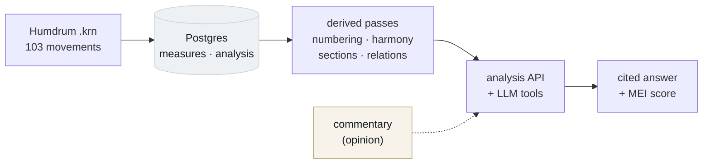

# ScoreChat

Ask questions about Beethoven's piano sonatas and get answers traceable to the score.

**Demo: [scorechat.fly.dev](https://scorechat.fly.dev)** — the viewer and chat, on free-tier
models (Gemini, OpenRouter), rate-limited per visitor. It may take a few seconds to wake.

The corpus is 32 sonatas — 103 movements — in Humdrum `**kern`, from
[craigsapp/beethoven-piano-sonatas](https://github.com/craigsapp/beethoven-piano-sonatas).
The score is the source of musical truth: the model chooses which stored facts to
fetch and how to phrase them, and invents none of them.



[Full architecture diagram](docs/architecture.md)

## Quickstart

The Humdrum sources are a git submodule, so clone with them:

```bash
git clone --recurse-submodules https://github.com/jt0321/scorechat
cd scorechat
uv venv && source .venv/bin/activate
uv pip install -e ".[dev]"
docker compose up -d                 # postgres
cp .env.example .env                 # add a provider key

git submodule update --init                  # only if you cloned without --recurse-submodules
python ingest_scores.py                      # parse, encode, analyse, store
python build_sections.py && python build_relations.py
python fetch_sources.py                      # commentary texts (not in the repo; pinned by checksum)
python ingest_commentary.py                  # passages anchored to sonata and movement
python embed_commentary.py --model gemini    # optional: vector search over the commentary
python build_claims.py                       # commentary claims, checked against the score

python ask.py "where is the recapitulation in the Moonlight finale?"
python server.py                     # viewer + API at localhost:8000
```

An existing database needs the migrations in `db/migrations/` applied in order;
`CLAUDE.md` lists them.

## CI/CD

`.github/workflows/fly-deploy.yml` runs on every push and pull request to `main`.
The test job runs `pytest` against an empty pgvector database with the schema
applied, with the `.krn` submodule checked out, so corpus-backed tests skip and
everything else runs. On a push to `main`, a passing suite then deploys to Fly.io
(`flyctl deploy --remote-only --ha=false`, one machine); pull requests are tested
but never deployed.

The deployed image only serves: it carries no corpus and runs no ingestion.
Everything it answers from lives in the hosted Postgres, which is populated
from a local database dump rather than by the pipeline.

## Model providers

`CHAT_PROVIDER` picks the default backend; any provider whose keys are present
is also selectable per question from the picker in the web client, which passes
a provider *name* to `/api/ask`. Keys stay server-side and never reach the
browser. `GET /api/providers` is what the picker is built from — each provider
with the env vars it needs and whether they are set.

| provider | key(s) | free tier |
|---|---|---|
| `openai` | `OPENAI_API_KEY` | no |
| `anthropic` | `ANTHROPIC_API_KEY` | no |
| `gemini` | `GEMINI_API_KEY` | yes |
| `openrouter` | `OPENROUTER_API_KEY` | yes — model slugs ending `:free` |
| `cloudflare` | `CLOUDFLARE_API_KEY` + `CLOUDFLARE_ACCOUNT_ID` | yes — Workers AI |
| `ollama` | none (`OLLAMA_BASE_URL`) | local |

OpenRouter and Cloudflare are OpenAI-compatible endpoints, so they need no
package beyond `langchain-openai`; Anthropic, Gemini and Ollama each need their
extra (`uv pip install -e ".[gemini]"`). Cloudflare needs the account id as
well as the key because the account is part of the URL.

**The model has to support tool calling.** That is how ScoreChat answers at
all, so a model without it returns prose with an empty trace — nothing backing
the claims. Defaults are chosen for it: `nvidia/nemotron-3-super-120b-a12b:free`
on OpenRouter, `@cf/meta/llama-3.3-70b-instruct-fp8-fast` on Workers AI. Free
catalogues churn, so set `CHAT_MODEL` when a default slug disappears.

## What it answers

Two shapes of question, both served by the same engine:

```bash
python ask.py "describe mm. 195-210 of the Pathetique's first movement in the context of the whole work"
python ask.py "in op 2 no 2 first movement, where does the opening material return?"
```

A third shape reaches the commentary alongside the score:

```bash
python ask.py "what did the old commentators say about the Moonlight's Allegretto, and does the score bear out the key they give it?"
```

The answer quotes Elterlein and Marx by page, as their view, and settles the
key from the score: Elterlein's D-flat major is the movement's engraved key.

Each answer prints the tool calls it was built from. **That trace is the
citation** — a claim with no supporting call under it is one to distrust.

## How the model reaches the corpus

One path, and it is a lookup. `pipeline/tools.py` binds six functions from
`pipeline/analysis_api.py` — `resolve_work`, `describe_span`,
`find_recurrences`, `compare_spans`, `get_key_plan`, `locate_in_form` — which
read stored analysis directly; the model chooses which to call and how to
phrase the result. `ask.py`, `GET /api/ask` and the web client all go through
it, and the client renders the returned trace as citation cards under the
answer, opening the score at the first bar range the calls named.

**The score is never embedded.** There used to be a vector layer over it —
4,519 prose summaries of measure windows in a `score_segments` table — and it
was removed, because neither shape of question is a retrieval problem: in
"describe mm. x–y" the measures are *given*, and "find recurring material" is
an edge in `span_relations`. The score is stored exactly, as JSONB in
`score_measures.symbolic_data`, and queried as data.

**Commentary is.** Three published texts about the sonatas — Elterlein (1879),
Marx (1895), Shedlock (1895) — are real prose, where similarity search is the
right tool. They are fetched rather than committed (`sources/manifest.toml`
pins each file), read into passages anchored to a sonata and, where the text
says so, a movement, and searched by full text and by vector, fused. Any
embedding provider with a free tier will do; the model is a property of the
corpus, so search uses the one the passages were embedded with. Commentary is
attributed opinion: it can be quoted beside the score, never written into it.

## Data model

| table | rows | what it holds |
|---|---|---|
| `works` | 103 | one row per movement |
| `score_sources` | 103 | the raw `.krn` and its checksum; every later pass re-reads the source from here |
| `score_measures` | 18,761 | canonical measure encoding, plus printed numbering and measure role |
| `measure_analyses` | 18,761 | versioned facts: keys, chords, directions, counts, texture |
| `span_analyses` | 9,449 | engraved sections and derived candidate spans |
| `span_relations` | 2,258 | `repeats`/`varies` between spans, with transposition and key evidence |

Derived passes (`renumber_measures.py`, `build_harmony.py`, `build_sections.py`,
`build_relations.py`) run from the database alone, so analysis is re-derivable in
seconds without re-parsing a single file.

## Current state

`python evaluate_form.py` scores the pipeline against ten movements whose form is
known independently: **49/50** at a four-bar tolerance.

Known gaps, in rough order of consequence:

- **Theme-and-variation movements return no relations at all.** Six movements
  have none; the matcher's own pruning bound excludes diminution, so a variation
  with twice the note events is never compared. `diminishes`/`augments` exist as
  relation types with no analyser behind them.
- **Key estimation is sticky.** 22 of 103 movements report a single key region;
  the Moonlight finale misses its G♯ minor second group.
- **Nothing ranks recapitulation candidates** — the one eval failure.
- **Bar numbers follow Durand 1915 (Dukas)**, the edition the encodings
  transcribe. An urtext such as Henle numbers first and second endings from the
  same bar, so numbers diverge in the 36 movements with alternate endings.

## Design notes

`CLAUDE.md` carries the rationale — why each rule is the way it is, and what
broke before it was. Worth reading before changing the analysis.

## Layout

```
analysis/     humdrum.py (read the .krn directly) · numbering.py · harmony.py
              sections.py · span_relations.py · analyzer.py (music21)
pipeline/     analysis_api.py · tools.py · providers.py · mei_converter.py
db/           models.py · schema.sql · store.py · migrations/
evaluation/   ground_truth.json · scoring.py
frontend/     index.html · score_viewer.html
tests/        160 tests
```
