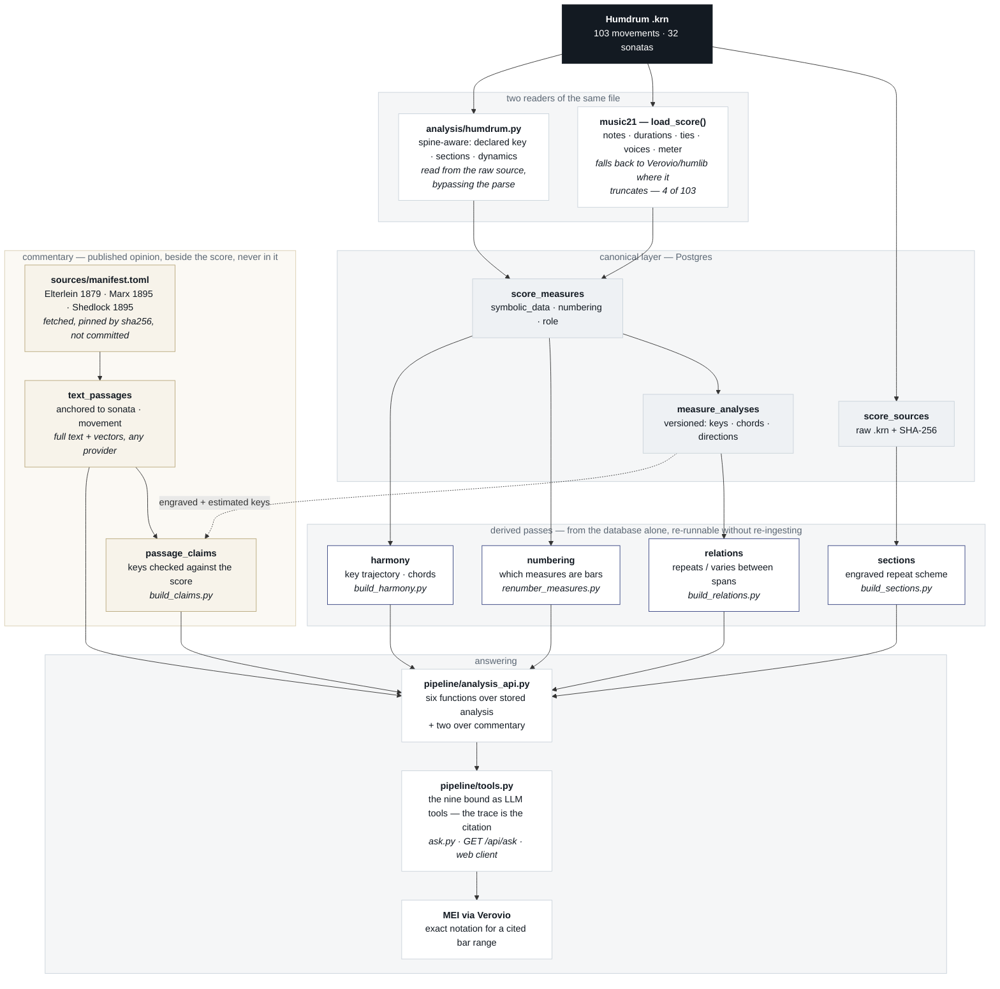

# ScoreChat architecture

The full pipeline, from the Humdrum source to a cited answer. Amber nodes are published commentary: kept beside the score, never in it. Everything in the "derived passes" box runs from the database alone and can be re-run without re-ingesting.

[Back to the README](../README.md)

